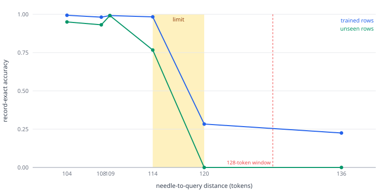
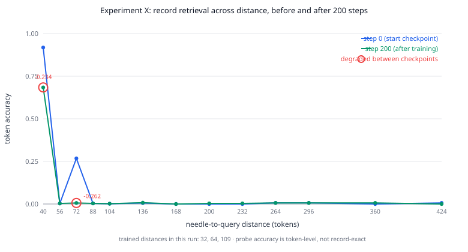
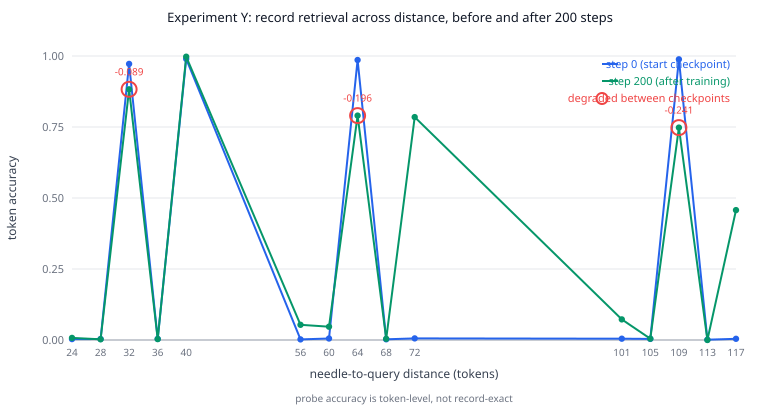

# ANX-VYRA

**Versatile Yet Resource-Aware Architecture** — an experimental sparse-attention language model
architecture from AnxLabs.

> ### What this is, and what it is not
>
> ANX-VYRA is a **research architecture**. It is a 16.4M-parameter model built to answer specific
> questions about retrieval and sparse routing, and the repository below is the honest record of
> what it does and does not do.
>
> **ANX-VYRA is not the Anx-U:50B model.** It is not a prototype, preview, scaled-down version, or
> stepping stone for Anx-U:50B, and nothing here should be read as a claim about that model's
> design or capabilities. Anx-U:50B is a separate effort. ANX-VYRA is an independent experiment and
> should be evaluated as one.
>
> It is not production-ready. It has no tokenizer beyond a 259-symbol byte vocabulary, no
> instruction tuning, no alignment work, and no serving path. It cannot chat, answer questions, or
> follow instructions. It does one thing: synthetic byte-level retrieval under controlled
> conditions, which is exactly what makes it useful for studying this architecture.

## Contents

- [Why this architecture exists](#why-this-architecture-exists)
- [Architecture](#architecture)
- [Quick start](#quick-start)
- [Reproducing the benchmarks](#reproducing-the-benchmarks)
- [Research findings](#research-findings)
- [Known limitations](#known-limitations)
- [Repository layout](#repository-layout)
- [Citation and license](#citation-and-license)

## Why this architecture exists

ANX-VYRA asks a narrow question with a broad consequence: **what actually sets the limit on how far
back a model can retrieve a fact, and what does learning a new distance cost you?**

The design combines three ideas that each reduce cost per token:

1. **Hybrid attention.** Half the layers use local sliding-window attention, half use full causal
   attention. This keeps most of the sequence cheap while preserving a path for long-range
   information.
2. **Sparse experts.** Each transformer block's feed-forward is a top-2-of-8 mixture of experts, so
   the model holds 16.4M parameters but activates 8.17M per token.
3. **Slicing optimizer.** `SliceAdam` only updates the expert slices that were actually used, so
   idle experts are not decayed toward zero by gradients that are structurally zero.

The interesting failures turned out to be about *learning dynamics*, not parameter count. See
[Research findings](#research-findings).

## Architecture

| Property | Value |
|---|---|
| Total parameters | 16,427,072 |
| Active parameters per token | 8,169,536 |
| Layers | 8 |
| Model width | 512 |
| Attention heads (query / key-value) | 8 / 2 (grouped, head dim 64) |
| Attention windows | `[128, None, 128, None, 128, None, 128, None]` — `None` = full causal |
| Position encoding | absolute RoPE (θ = 10000), applied to queries and keys |
| Feed-forward | top-2-of-8 mixture of experts, intermediate width 112 |
| Router | stable sort (`argsort(..., stable=True)`), softmax over the top-2 logits |
| Norm | RMSNorm (ε = 1e-6) |
| Embedding | 259 tokens (256 byte values + BOS/EOS/PAD), tied output projection |
| Sequence length | 512 |
| Attention sink | one learned scalar per head, concatenated into the softmax denominator |
| Optimizer | `SliceAdam`, β = (0.9, 0.999), ε = 1e-8, grad clip 1.0 |

Two implementation details matter enough to call out, because both are easy to get subtly wrong:

- **Stable routing.** `torch.topk` breaks ties by index, and which expert wins a near-tie can shift
  with kernel numerics. `stable_experts_forward` sorts explicitly so the same logits always select
  the same experts. Without this, a CPU run and a GPU run diverge enough to invalidate comparisons.
- **The `LR` global.** `SliceAdam` reads the **module-level** `LR` constant at update time, not a
  constructor argument. Set `optim.LR` and assert it before every step. A trainer that forgets this
  silently trains at the default rate while its logs claim otherwise — this cost us two invalidated
  runs before we caught it. The `SliceAdam(lr=...)` constructor now sets the global to make the
  contract harder to break, and `test_slice_adam_first_update_equals_lr` verifies that a 3e-4 first
  update lands at `3.000498e-04`.

## Quick start

Requires Python 3.10+ and PyTorch 2.x. CPU is sufficient; everything here runs on CPU.

```bash
git clone https://github.com/AnxLabs/Anx-Vyra.git
cd Anx-Vyra
python -m venv .venv && source .venv/bin/activate
pip install -r requirements.txt
```

Verify the architecture is intact:

```bash
pytest tests/ -q
```

Inspect the model:

```python
import torch
from anx_vyra.model import build_arm, counts

model = build_arm("R")
print(counts(model))          # {'total': 16427072, 'active': 8169536, ...}

with torch.no_grad():
    logits = model(torch.zeros(2, 32, dtype=torch.long))
print(logits.shape)           # torch.Size([2, 32, 259])
```

## Reproducing the benchmarks

The benchmark trains the model to retrieve a needle at a chosen token distance and reports
**record-exact** accuracy — all 8 payload bytes correct — on both trained rows and rows it has never
seen.

```bash
python benchmarks/reproduce_retrieval.py --distance 32  --steps 200
python benchmarks/reproduce_retrieval.py --distance 109 --steps 200
python benchmarks/reproduce_retrieval.py --distance 120 --steps 200
```

The task: a row carries one or more `MEM:` records early, then filler, then a `QUERY:`. The model
must emit the matching record's 8-byte payload. The **distance** is the exact token gap from the last
byte of the record to the first byte of the query marker, and it is the variable that matters.

Row geometry follows from the distance:

```
piece           = 27 + filler
distance        = filler + 8
copies_per_row  = min(8, 510 // piece)
```

So distance 32 gives 8 records per row, distance 64 gives 6, and distance 109 gives 3.

**Please read this before comparing numbers.** The published results are *continuations* from a
pretrained checkpoint that is **not distributed here**. This script trains from scratch, which is a
different experiment.

We ran it so you do not have to guess what it does. At distance 32, 40 rows, 200 steps, lr 3e-4:

| | record-exact |
|---|---|
| trained rows | 0.844 |
| unseen rows | 0.000 |

From scratch the model **memorises the 40 training rows and transfers nothing**. The published
unseen numbers depend on the pretrained checkpoint. This script is a working harness and a
reproducible baseline, not a reproduction of the published accuracies — and the gap between 0.844
trained and 0.000 unseen is itself a data point about how little this task affords generalisation at
this scale. Archived in
[`results/from_scratch_baseline_d32.json`](results/from_scratch_baseline_d32.json).

Measurements were taken on a single NVIDIA Tesla T4 (16 GB), ~720–800 ms per optimizer step at batch
4 with 512-token rows, and **1.41–1.60 GiB peak GPU memory allocated**. Memory is flat across
distances because every row is padded to 512 tokens regardless of how many records it holds — which
is why the retrieval limit is representational rather than a memory limit.

## Research findings

All numbers below are record-exact accuracy on **40 unseen rows** unless stated otherwise, with 40
disjoint training rows per condition, at learning rate 3e-4, continuing from the same pretrained
checkpoint with a fresh optimizer, 200 steps and 5 passes per row. Full data is in
[`results/`](results/).

### 1. The retrieval limit is distance, not record count

| distance | records/row | inside 128-token window | trained | unseen | learned |
|---|---|---|---|---|---|
| 104 | 4 | yes | 0.994 | 0.950 | yes |
| 108 | 4 | yes | 0.981 | 0.931 | yes |
| 109 | 3 | yes | 0.992 | 0.992 | yes |
| 114 | 3 | yes | 0.983 | 0.767 | yes |
| 120 | 3 | yes | 0.283 | 0.000 | **no** |
| 136 | 3 | no | 0.225 | 0.000 | **no** |

Retrieval holds at distance **114** and collapses at **120**. The 128-token attention window is *not*
the boundary — failure begins at least 8 tokens inside it.

Record count is exonerated: distance 109 with 3 records per row learned (0.992 unseen), while
distance 120 with the *same* 3 records per row failed (0.000). Same record count, opposite outcomes.

Distance 136 was run three times independently and reproduced identically each time (0.225 train /
0.000 unseen), which is the reproducibility evidence available for a single-seed design.



### 2. Interference between distances is trainable in a mix — but the distance rule stays sharp

Training one new distance at 3e-4, alone, **destroyed the previously learned 64-token ability on five
of six arms** (0.97 → 0.000 at the first checkpoint). It survived only on the arm closest to the
64-token task (distance 104), and even there it degraded to 0.67. Meanwhile the 32-token ability held
(0.99–1.00) and general validation held (0.700–0.710) on every arm — a specific interference, not a
global collapse.

**Experiment X substantially resolves this.** Training 32, 64 and 109 *together*, at the same 5 passes
per distance W gave each arm, learned all three and kept 64-token retrieval:

| distance | trained | unseen |
|---|---|---|
| 32 | 0.894 | 0.813 |
| 64 | 0.975 | 0.929 |
| 109 | 0.975 | 0.967 |

So W's result was a **mixing artefact, not a capacity ceiling**: the failure came from fitting one new
distance over an old one in isolation, not from the model being unable to hold more than one distance.

What that resolution does *not* buy, and what remains open:

- **It is a comparison of two training configurations, not an architectural claim.** One run per
  configuration; no seed-level replication and no superiority claim is warranted.
- **Mixing costs a little accuracy where it learns.** At distance 109 the mixed run reaches 0.967
  unseen; W's single-distance arm on the same distance reached 0.992.
- **The distance ceiling did not move.** X never attempted 120 or 136, the distances W failed.
- **The retrieval rule is distance-sharp.** Two untrained neighbour probes degraded (see
  [Known limitations](#known-limitations)).



The chart above is the probe profile discussed under [Known limitations](#known-limitations): the two
circled points are the only distances where accuracy dropped materially, and everything from distance
88 outward was already at floor before training. Curated record:
[`results/experiment_x_multi_distance.json`](results/experiment_x_multi_distance.json).

This remains the most important finding in the repository: **the obstacle to scaling this design is
continual-learning behaviour, not the attention window and not memory.**

### 3. Learning rate was the difference between working and not working

At 3e-4 the same 64-token task reached 0.970 trained / 0.840 unseen. At 1e-4, on the same data and
architecture, it reached 0.015 / 0.000. A 3× rate difference produced the entire capability
difference, with no change to the model.

Because a torch seed has no effect in this trainer (no dropout; batch order comes from a fixed plan),
that replication was done at the **data** level — two independent corpora — rather than by reseeding.
Both agreed: trained 0.970 / 0.975, unseen 0.840 / 0.890.

### 4. What we have not shown

We have not shown that ANX-VYRA scales, or that these findings transfer to larger widths or depths.

On interference specifically, the picture is now split rather than wholly negative: a mixed-distance
run does learn several distances and retain the earlier one (finding 2), but it degrades untrained
neighbouring distances, and it has not been shown to generalise to a *continuous* range of distances
rather than a trained set of them. The jittered-filler fix proposed for that was run as
Experiment Y, and it did not work (finding 5).

### 5. Jittering the distance did not smooth it (Experiment Y)

**Jittering the distance did not smooth it.** Experiment Y took X's ending weights and trained
with filler length jittered by ±8 around each of the three anchors, turning three trained distances
into fifteen, with eleven further distances never trained as a test of interpolation. The test failed:
no never-trained distance produced a single exact record, and their mean token accuracy fell from
0.067 to 0.023. It also degraded the anchors it was meant to repair, to 0.425 / 0.229 / 0.133
record-exact on the same unseen rows where X held 0.813 / 0.929 / 0.967 (token accuracy 0.883 / 0.790
/ 0.748, down from 0.972 / 0.986 / 0.989). Eight of the fifteen geometries it trained finished at
exactly zero training record-exact despite forty presentations each, though partial token-level
learning did occur there.

One thing the run did buy: distance 72, X's other collapsed +8 offset, went from 0.006 to 0.785 token
accuracy on unseen rows. So the fix moved capability to the band edges at the cost of the anchors
rather than smoothing anything.

The conclusion is narrower than "jitter is bad" and stronger than "that fix didn't work": within a
single run, exposure to a band of neighbouring distances bought no generalisation across that band.
The distance-sharp behaviour seen in X is not a training-mix artefact that another variation of the
data mix can regularise away. A different mechanism, such as distance-relative position features, is
what the evidence now points at. One caveat belongs with the result: Y spread fifteen geometries
across eight rows each where X gave each distance forty, so part of the unseen degradation may be
reduced row diversity rather than jitter itself. Details and per-geometry numbers:
[`results/experiment_y_jitter_fix.json`](results/experiment_y_jitter_fix.json).



The chart plots per-geometry unseen token accuracy before and after. The anchors that worked at step
0 are the points that fall; the band geometries that never reached record level sit near the axis in
both series.

### 6. Resuming from update 200 kept teaching X64, and broke Y72 retention (INCONCLUSIVE)

The 64-token needle task (X64) had been stuck at zero record-exact on held-out rows at update 200.
The next question was whether it was stuck or only slow, so the run was resumed from the update-200
checkpoint with the same recipe (replay weight 0.25, one global clip at 1.0) for 100 more updates,
under a stop rule written down in advance (`prereg/stop_rule_300.json`). One run, one seed.

X64 was slow, not stuck. Held-out record-exact (rows disjoint from every training row) went
0 → 11 → 29 → 46 → 92 of 240 at updates 200 / 225 / 250 / 275 / 300, and held-out token accuracy went
257 → 1418 → 1542 → 1603 → 1687 of 1920 (13.4% → 87.9%). X32 and X109 ended above where they started
(264/320 and 109/120 at update 300).

Retention of Y72, the 72-token needle distance, failed. Y72 record-exact on its 200 held-out segments
was 165 at update 200 and 168 at 225, then **137, 137 and 153 at 250, 275 and 300**, against a floor of
160. The pre-registered rule therefore returns **INCONCLUSIVE**: not stuck, but retention failed at
every checkpoint from 250 on, and no success may be claimed. Curated record:
[`results/experiment_r300_continuation.json`](results/experiment_r300_continuation.json).

### 7. Doubling the replay weight did not fix Y72, and cost X64 (FAIL_RETENTION)

The obvious single-variable fix for finding 6 was to raise the replay weight on the Y72 rehearsal rows
from 0.25 to 0.5. It was run once, resumed from the update-225 checkpoint of the 200→300 run and
stopped at 300, against gates written beforehand (`prereg/y72fix_lambda05.json`): Y72 ≥ 160/200 at
250, 275 and 300 (retention), X64 held-out ≥ 11/240 at every checkpoint plus a ≥ 10.0 point token gain
(acquisition), X32 ≥ 128/320 and X109 ≥ 90/120 (non-regression).

Result: **FAIL_RETENTION**. Y72 was 152, 147 and 152 of 200 at 250, 275 and 300, short of 160 by 8, 13
and 8. The 0.25 control was 137, 137 and 153. So the larger weight narrowed the drop at 250 and 275,
and was level with the control at 300. It paid for that in X64: held-out record-exact 17, 29 and 42
of 240 against the control's 29, 46 and 92 (token accuracy 1618 vs 1687 of 1920 at 300). Acquisition
and non-regression passed their gates. One seed; a metric that flips 49 to 61 of its 200 items per
25 updates (finding 8) can move by more than the 8 to 13 item shortfall by chance, so this shows that
0.5 did not meet the bar, not that the weight has no effect on retention. Curated record:
[`results/experiment_y72fix_lambda05.json`](results/experiment_y72fix_lambda05.json).

### 8. The Y72 gate was noisier than the effects it was asked to detect (measurement study)

Before spending another run, the noise in the Y72 metric was measured on the eight existing
checkpoints, CPU only, no training. Two checkpoints 25 updates apart disagree on 49 to 61 of the 200
held-out segments (27% on average); a single real optimizer step already flips 13.3 ± 4.0. The
single-checkpoint standard deviation is 5.2 to 5.7 segments (2.6 to 2.8 points), with no detectable
row clustering (row ICC −0.015), which makes the smallest effect one checkpoint can resolve
about 14 segments (7.0 points). The mean of the three late checkpoints has a cluster-bootstrap SE
of 3.7 (λ0.25) and 3.9 (λ0.5) segments. The old rule "every checkpoint ≥ 160" therefore has a large
chance of failing a model that sits at the floor.

Gradient measurements at the λ0.25 checkpoints found the replay and X gradients mostly pulling against
each other (mean cosine −0.106, −0.061 and −0.088 at updates 225, 250 and 275; +0.031 at 300) and the
single global clip binding on 96 to 100% of batches. A one-step probe of 12 real updates found
per-task clipping gives Y72 +1.42 segments (SE 0.54) over the global clip, and gradient projection
+0.5 (SE 0.29): real but far below one run's resolution. The saved data held no further Y72
held-out items, so the study could not lower the noise itself. Curated record:
[`results/experiment_y72-noise_noise_floor_clip_split.json`](results/experiment_y72-noise_noise_floor_clip_split.json).

### 9. A 600-segment held-out set: both runs fail it, and the noise did not shrink as predicted

A new Y72 held-out set of 600 segments was generated with the existing generator and seed policy,
checked against every earlier row for seed, row, payload, filler and 16-byte-window overlap (none),
and pre-registered with its hashes, a rescaled gate (sum over updates 250, 275, 300 ≥ 1440 and each
≥ 432 of 600) and noise predictions, all committed before any checkpoint was scored on it
(`prereg/y72_heldout_v2.json`).

Scoring the existing checkpoints on it, afterwards: λ0.25 scored 363, 390 and 454 and λ0.5 450, 421
and 420 at 250, 275 and 300, sums of **1207 and 1291 against 1440: both fail**, and two of three checkpoints in
each run (λ0.25: 363, 390; λ0.5: 421, 420) also sit below the 432 guard. λ0.5 minus λ0.25 on the
mean of the three is +28 segments (+4.67 points), z 3.01 with a cluster-bootstrap SE of 9.3, firmer
than the +8 (z 2.06) on the 200-item set. The new set is about 4 points harder than the old one at
the later checkpoints.

The registered prediction was half right. Single-checkpoint noise scaled as predicted (SD 9.3 to 9.7
segments, 1.6 points; predicted 8.9 to 9.8). The mean of three checkpoints did not: its SE is 8.3 to
9.0 segments against a predicted 5.3 to 6.8, so the checkpoints share a component and averaging them
buys less than independence would. Curated record:
[`results/experiment_y72-heldout-v2_heldout_600.json`](results/experiment_y72-heldout-v2_heldout_600.json).

## Known limitations

Stated plainly, because a research repository is only useful if its edges are visible.

- **Not a language model in any usable sense.** 259-token byte vocabulary, synthetic data only, no
  instruction following, no conversation, no alignment. It cannot be used as a chatbot.
- **Not Anx-U:50B.** Different project, different scale, different purpose. Nothing here is a
  preview of it.
- **Single seed per condition.** The torch seed is inert in this trainer, so replication was done by
  resampling the corpus. That is weaker evidence than multi-seed runs, and no architectural
  superiority claim is justified by these numbers.
- **Narrow task family.** All retrieval results come from one synthetic needle-in-filler format.
  Generalisation to natural text is untested and unknown.
- **From-scratch training does not generalise.** Trained from scratch on 40 rows at 3e-4, the model
  reaches 0.844 record-exact on those rows and **0.000 on unseen ones** — it memorises and transfers
  nothing. Every "unseen" number in this README comes from a continuation of a pretrained checkpoint
  that is not distributed, so those numbers cannot be reproduced from this repository alone. The
  from-scratch run is archived in `results/from_scratch_baseline_d32.json`.
- **Interference is manageable, not solved.** Learning a new distance alone can erase an old one, but
  training distances together preserves the old one (0.929 unseen at 64 tokens). What a mixed run does
  *not* do is interpolate: two untrained neighbouring probes degraded after training, at distance 40
  (0.918 → 0.684 token accuracy) and distance 72 (0.267 → 0.006). Both sit exactly 8 tokens past a
  trained distance. The model appears to form distance-sharp representations at the offsets it is
  shown rather than a smooth rule, so an untrained distance next door is not covered. This is inferred
  from two degraded points in one run; the proposed fix (jittering filler lengths around each target)
  was run as Experiment Y and did not work (finding 5).
- **Retention of Y72 is not solved.** Continuing training taught X64 but dropped Y72 below its pre-registered
  floor at every checkpoint from update 250 (findings 6 and 7), doubling the replay weight did not fix it,
  and the 600-segment set (finding 9) fails both runs. Every one of these is a single run on a single seed. A per-task-clip fix is registered ([`prereg/y72fix2.md`](prereg/y72fix2.md)) from CPU probes only; it has not been run, and its estimated chance of passing all gates is about 0.6.
- **Distance limit is empirical.** We measured where it breaks (between 114 and 120). We have not
  proven *why* beyond ruling out record count and window size.
- **CPU reference path.** Reported results were produced on GPU and validated against CPU evaluation
  rates within 0.005, not bitwise. Top-2 routing flips under ~1e-4 numerical differences, so exact
  logit agreement between devices is not achievable and was not required.
- **No tokenizer, no checkpoint release.** The pretrained checkpoint used to produce the published
  continuation results is not included.
- **Optimizer has a sharp edge.** The module-level `LR` global is a real hazard; see the warning
  above.
- **A second forward drops the first expert selection.** `expert_selection` reports only the last
  forward, and SliceAdam updates only the dict it is given. Replay training that runs a second
  forward before the one step has to capture the first selection and union the second. Single-forward
  training is unchanged. The packaged replay caller does that union and records whether each expert
  slice was selected, had a nonzero gradient, had its optimizer clock advanced, and had a stored
  value change. A clock advance is not recorded as a value change. See `docs/PACKAGING.md`.

## Repository layout

```
anx_vyra/
  model.py       reference architecture: attention, experts, routing, arm construction
  optim.py       SliceAdam, the expert-sliced optimizer
  data.py        synthetic corpora and needle-retrieval geometry
tests/           integrity tests (parameter counts, causality, routing, optimizer, geometry)
benchmarks/      reproduce_retrieval.py - train and measure one distance end to end
results/         machine-readable results from the reported experiments
tools/           publish_experiment.py - fail-closed publisher for new experiment results
tools/experiment_packaging/  exact notebook builder and isolated CPU preflight gate
docs/            figures, experiment log, publishing workflow, packaging rebuild
```

## Citation and license

If you use this work, please cite it as:

```
AnxLabs. ANX-VYRA: Versatile Yet Resource-Aware Architecture (2026).
https://github.com/AnxLabs/Anx-Vyra
```

Licensed under the **Apache License 2.0** — see [LICENSE](LICENSE). Chosen over MIT for its explicit
patent grant. Copyright 2026 AnxLabs.
