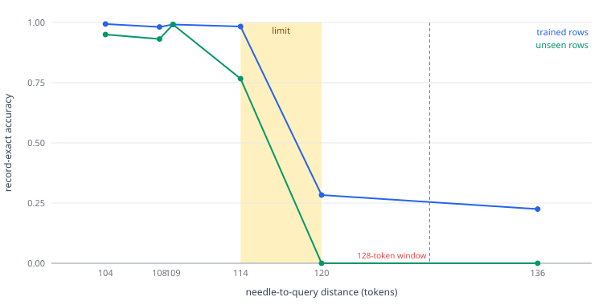

# ANX-VYRA

**Versatile Yet Resource-Aware Architecture** — an experimental sparse-attention language model
architecture from AnxLabs.

> ### What this is, and what it is not
>
> ANX-VYRA is a **research architecture**. It is a 16.4M-parameter model built to answer specific
> questions about retrieval and sparse routing, and the repository below is the honest record of
> what it does and does not do.
>
> **ANX-VYRA is not the Anx-U:50B model.** It is not a prototype, preview, scaled-down version, or
> stepping stone for Anx-U:50B, and nothing here should be read as a claim about that model's
> design or capabilities. Anx-U:50B is a separate effort. ANX-VYRA is an independent experiment and
> should be evaluated as one.
>
> It is not production-ready. It has no tokenizer beyond a 259-symbol byte vocabulary, no
> instruction tuning, no alignment work, and no serving path. It cannot chat, answer questions, or
> follow instructions. It does one thing: synthetic byte-level retrieval under controlled
> conditions, which is exactly what makes it useful for studying this architecture.

## Contents

- [Why this architecture exists](#why-this-architecture-exists)
- [Architecture](#architecture)
- [Quick start](#quick-start)
- [Reproducing the benchmarks](#reproducing-the-benchmarks)
- [Research findings](#research-findings)
- [Known limitations](#known-limitations)
- [Repository layout](#repository-layout)
- [Citation and license](#citation-and-license)

## Why this architecture exists

ANX-VYRA asks a narrow question with a broad consequence: **what actually sets the limit on how far
back a model can retrieve a fact, and what does learning a new distance cost you?**

The design combines three ideas that each reduce cost per token:

1. **Hybrid attention.** Half the layers use local sliding-window attention, half use full causal
   attention. This keeps most of the sequence cheap while preserving a path for long-range
   information.
2. **Sparse experts.** Each transformer block's feed-forward is a top-2-of-8 mixture of experts, so
   the model holds 16.4M parameters but activates 8.17M per token.
3. **Slicing optimizer.** `SliceAdam` only updates the expert slices that were actually used, so
   idle experts are not decayed toward zero by gradients that are structurally zero.

The interesting failures turned out to be about *learning dynamics*, not parameter count. See
[Research findings](#research-findings).

## Architecture

| Property | Value |
|---|---|
| Total parameters | 16,427,072 |
| Active parameters per token | 8,169,536 |
| Layers | 8 |
| Model width | 512 |
| Attention heads (query / key-value) | 8 / 2 (grouped, head dim 64) |
| Attention windows | `[128, None, 128, None, 128, None, 128, None]` — `None` = full causal |
| Position encoding | absolute RoPE (θ = 10000), applied to queries and keys |
| Feed-forward | top-2-of-8 mixture of experts, intermediate width 112 |
| Router | stable sort (`argsort(..., stable=True)`), softmax over the top-2 logits |
| Norm | RMSNorm (ε = 1e-6) |
| Embedding | 259 tokens (256 byte values + BOS/EOS/PAD), tied output projection |
| Sequence length | 512 |
| Attention sink | one learned scalar per head, concatenated into the softmax denominator |
| Optimizer | `SliceAdam`, β = (0.9, 0.999), ε = 1e-8, grad clip 1.0 |

Two implementation details matter enough to call out, because both are easy to get subtly wrong:

- **Stable routing.** `torch.topk` breaks ties by index, and which expert wins a near-tie can shift
  with kernel numerics. `stable_experts_forward` sorts explicitly so the same logits always select
  the same experts. Without this, a CPU run and a GPU run diverge enough to invalidate comparisons.
- **The `LR` global.** `SliceAdam` reads the **module-level** `LR` constant at update time, not a
  constructor argument. Set `optim.LR` and assert it before every step. A trainer that forgets this
  silently trains at the default rate while its logs claim otherwise — this cost us two invalidated
  runs before we caught it. The `SliceAdam(lr=...)` constructor now sets the global to make the
  contract harder to break, and `test_slice_adam_first_update_equals_lr` verifies that a 3e-4 first
  update lands at `3.000498e-04`.

## Quick start

Requires Python 3.10+ and PyTorch 2.x. CPU is sufficient; everything here runs on CPU.

```bash
git clone https://github.com/AnxLabs/Anx-Vyra.git
cd Anx-Vyra
python -m venv .venv && source .venv/bin/activate
pip install -r requirements.txt
```

Verify the architecture is intact:

```bash
pytest tests/ -q
```

Inspect the model:

```python
import torch
from anx_vyra.model import build_arm, counts

model = build_arm("R")
print(counts(model))          # {'total': 16427072, 'active': 8169536, ...}

with torch.no_grad():
    logits = model(torch.zeros(2, 32, dtype=torch.long))
print(logits.shape)           # torch.Size([2, 32, 259])
```

## Reproducing the benchmarks

The benchmark trains the model to retrieve a needle at a chosen token distance and reports
**record-exact** accuracy — all 8 payload bytes correct — on both trained rows and rows it has never
seen.

```bash
python benchmarks/reproduce_retrieval.py --distance 32  --steps 200
python benchmarks/reproduce_retrieval.py --distance 109 --steps 200
python benchmarks/reproduce_retrieval.py --distance 120 --steps 200
```

The task: a row carries one or more `MEM:` records early, then filler, then a `QUERY:`. The model
must emit the matching record's 8-byte payload. The **distance** is the exact token gap from the last
byte of the record to the first byte of the query marker, and it is the variable that matters.

Row geometry follows from the distance:

```
piece           = 27 + filler
distance        = filler + 8
copies_per_row  = min(8, 510 // piece)
```

So distance 32 gives 8 records per row, distance 64 gives 6, and distance 109 gives 3.

**Please read this before comparing numbers.** The published results are *continuations* from a
pretrained checkpoint that is **not distributed here**. This script trains from scratch, which is a
different experiment.

We ran it so you do not have to guess what it does. At distance 32, 40 rows, 200 steps, lr 3e-4:

| | record-exact |
|---|---|
| trained rows | 0.844 |
| unseen rows | 0.000 |

From scratch the model **memorises the 40 training rows and transfers nothing**. The published
unseen numbers depend on the pretrained checkpoint. This script is a working harness and a
reproducible baseline, not a reproduction of the published accuracies — and the gap between 0.844
trained and 0.000 unseen is itself a data point about how little this task affords generalisation at
this scale. Archived in
[`results/from_scratch_baseline_d32.json`](results/from_scratch_baseline_d32.json).

Measurements were taken on a single NVIDIA Tesla T4 (16 GB), ~720–800 ms per optimizer step at batch
4 with 512-token rows, and **1.41–1.60 GiB peak GPU memory allocated**. Memory is flat across
distances because every row is padded to 512 tokens regardless of how many records it holds — which
is why the retrieval limit is representational rather than a memory limit.

## Research findings

All numbers below are record-exact accuracy on **40 unseen rows** unless stated otherwise, with 40
disjoint training rows per condition, at learning rate 3e-4, continuing from the same pretrained
checkpoint with a fresh optimizer, 200 steps and 5 passes per row. Full data is in
[`results/`](results/).

### 1. The retrieval limit is distance, not record count

| distance | records/row | inside 128-token window | trained | unseen | learned |
|---|---|---|---|---|---|
| 104 | 4 | yes | 0.994 | 0.950 | yes |
| 108 | 4 | yes | 0.981 | 0.931 | yes |
| 109 | 3 | yes | 0.992 | 0.992 | yes |
| 114 | 3 | yes | 0.983 | 0.767 | yes |
| 120 | 3 | yes | 0.283 | 0.000 | **no** |
| 136 | 3 | no | 0.225 | 0.000 | **no** |

Retrieval holds at distance **114** and collapses at **120**. The 128-token attention window is *not*
the boundary — failure begins at least 8 tokens inside it.

Record count is exonerated: distance 109 with 3 records per row learned (0.992 unseen), while
distance 120 with the *same* 3 records per row failed (0.000). Same record count, opposite outcomes.

Distance 136 was run three times independently and reproduced identically each time (0.225 train /
0.000 unseen), which is the reproducibility evidence available for a single-seed design.



### 2. The real blocker is interference between distances, not architecture

Training one new distance at 3e-4 **destroyed the previously learned 64-token ability on five of six
arms** (0.97 → 0.000 at the first checkpoint). It survived only on the arm closest to the 64-token
task (distance 104), and even there it degraded to 0.67.

Meanwhile the 32-token ability held (0.99–1.00) and general validation held (0.700–0.710) on every
arm. So this is not a global collapse — it is specific, catastrophic interference from fitting a new
distance over an old one at a rate high enough to overwrite it.

This matters more than any parameter-count result: **the obstacle to scaling this design is
continual-learning behaviour, not the attention window and not memory.**

### 3. Learning rate was the difference between working and not working

At 3e-4 the same 64-token task reached 0.970 trained / 0.840 unseen. At 1e-4, on the same data and
architecture, it reached 0.015 / 0.000. A 3× rate difference produced the entire capability
difference, with no change to the model.

Because a torch seed has no effect in this trainer (no dropout; batch order comes from a fixed plan),
that replication was done at the **data** level — two independent corpora — rather than by reseeding.
Both agreed: trained 0.970 / 0.975, unseen 0.840 / 0.890.

### 4. What we have not shown

We have not shown that ANX-VYRA scales, that these findings transfer to larger widths or depths, or
that a mixed-distance curriculum solves the interference problem. Those are open. The interference
result in particular is a *negative* result and is reported as one.

## Known limitations

Stated plainly, because a research repository is only useful if its edges are visible.

- **Not a language model in any usable sense.** 259-token byte vocabulary, synthetic data only, no
  instruction following, no conversation, no alignment. It cannot be used as a chatbot.
- **Not Anx-U:50B.** Different project, different scale, different purpose. Nothing here is a
  preview of it.
- **Single seed per condition.** The torch seed is inert in this trainer, so replication was done by
  resampling the corpus. That is weaker evidence than multi-seed runs, and no architectural
  superiority claim is justified by these numbers.
- **Narrow task family.** All retrieval results come from one synthetic needle-in-filler format.
  Generalisation to natural text is untested and unknown.
- **From-scratch training does not generalise.** Trained from scratch on 40 rows at 3e-4, the model
  reaches 0.844 record-exact on those rows and **0.000 on unseen ones** — it memorises and transfers
  nothing. Every "unseen" number in this README comes from a continuation of a pretrained checkpoint
  that is not distributed, so those numbers cannot be reproduced from this repository alone. The
  from-scratch run is archived in `results/from_scratch_baseline_d32.json`.
- **Interference is unsolved.** Learning a new distance can erase an old one. This is the open
  problem, not a solved one.
- **Distance limit is empirical.** We measured where it breaks (between 114 and 120). We have not
  proven *why* beyond ruling out record count and window size.
- **CPU reference path.** Reported results were produced on GPU and validated against CPU evaluation
  rates within 0.005, not bitwise. Top-2 routing flips under ~1e-4 numerical differences, so exact
  logit agreement between devices is not achievable and was not required.
- **No tokenizer, no checkpoint release.** The pretrained checkpoint used to produce the published
  continuation results is not included.
- **Optimizer has a sharp edge.** The module-level `LR` global is a real hazard; see the warning
  above.

## Repository layout

```
anx_vyra/
  model.py       reference architecture: attention, experts, routing, arm construction
  optim.py       SliceAdam, the expert-sliced optimizer
  data.py        synthetic corpora and needle-retrieval geometry
tests/           integrity tests (parameter counts, causality, routing, optimizer, geometry)
benchmarks/      reproduce_retrieval.py - train and measure one distance end to end
results/         machine-readable results from the reported experiments
docs/            figures and supporting notes
```

## Citation and license

If you use this work, please cite it as:

```
AnxLabs. ANX-VYRA: Versatile Yet Resource-Aware Architecture (2026).
https://github.com/AnxLabs/Anx-Vyra
```

Licensed under the **Apache License 2.0** — see [LICENSE](LICENSE). Chosen over MIT for its explicit
patent grant. Copyright 2026 AnxLabs.
